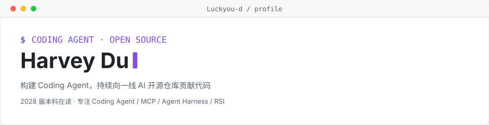
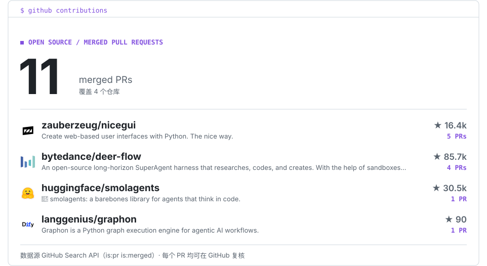

<picture>
  <source media="(prefers-color-scheme: dark)" srcset="./assets/hero-dark.svg">
  
</picture>

<!-- CONTRIB:BEGIN -->
<picture>
  <source media="(prefers-color-scheme: dark)" srcset="./assets/contrib-dark.svg">
  
</picture>
<!-- CONTRIB:END -->

## 开源贡献

<!-- PRLIST:BEGIN -->
- [Tencent/teamai-cli#2108](https://github.com/Tencent/teamai-cli/pull/2108)：test(trae): give the shared-file case a budget the loaded runner has time for
- [huggingface/smolagents#3242](https://github.com/huggingface/smolagents/pull/3242)：fix: send a base_url model with the call instead of to the client
- [zauberzeug/nicegui#6500](https://github.com/zauberzeug/nicegui/pull/6500)：Fix previous_value for elements with dict-backed options
- [bytedance/deer-flow#8423](https://github.com/bytedance/deer-flow/pull/8423)：fix(feishu): keep a card's markdown image from failing every update
- [zauberzeug/nicegui#6509](https://github.com/zauberzeug/nicegui/pull/6509)：Create background tasks on the caller's event loop outside the app
- [langgenius/graphon#392](https://github.com/langgenius/graphon/pull/392)：build: allow Python 3.14
- [zauberzeug/nicegui#6495](https://github.com/zauberzeug/nicegui/pull/6495)：Fix unquoted lists and dicts on Vue-binding props
- [zauberzeug/nicegui#6488](https://github.com/zauberzeug/nicegui/pull/6488)：Refresh the Redis TTL of tab storages in use
- [bytedance/deer-flow#8153](https://github.com/bytedance/deer-flow/pull/8153)：fix(memory): reject duplicate fact ids in imports regardless of entry order
- [bytedance/deer-flow#7971](https://github.com/bytedance/deer-flow/pull/7971)：fix(gateway): keep batch cancellation running when the scheduler store fails
- [zauberzeug/nicegui#6473](https://github.com/zauberzeug/nicegui/pull/6473)：Keep the call order of JavaScript calls without await
- [bytedance/deer-flow#7892](https://github.com/bytedance/deer-flow/pull/7892)：fix(harness): reject Windows reserved device names in thread ID validation
<!-- PRLIST:END -->

<picture>
  <source media="(prefers-color-scheme: dark)" srcset="https://raw.githubusercontent.com/Luckyou-d/Luckyou-d/output/github-snake-dark.svg">
  
</picture>

