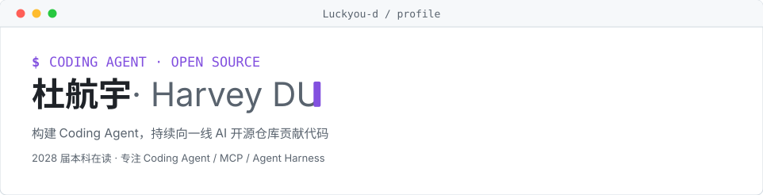
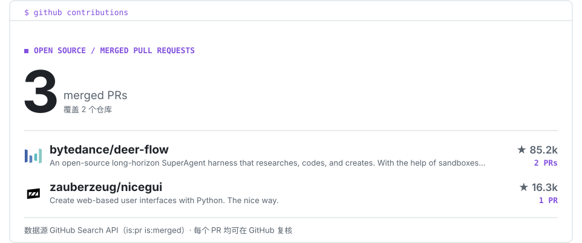

<picture>
  <source media="(prefers-color-scheme: dark)" srcset="./assets/hero-dark.svg">
  
</picture>

<!-- CONTRIB:BEGIN -->
<picture>
  <source media="(prefers-color-scheme: dark)" srcset="./assets/contrib-dark.svg">
  
</picture>
<!-- CONTRIB:END -->

## 开源贡献

<!-- PRLIST:BEGIN -->
- [bytedance/deer-flow#7971](https://github.com/bytedance/deer-flow/pull/7971)：fix(gateway): keep batch cancellation running when the scheduler store fails
- [zauberzeug/nicegui#6473](https://github.com/zauberzeug/nicegui/pull/6473)：Keep the call order of JavaScript calls without await
- [bytedance/deer-flow#7892](https://github.com/bytedance/deer-flow/pull/7892)：fix(harness): reject Windows reserved device names in thread ID validation
<!-- PRLIST:END -->
